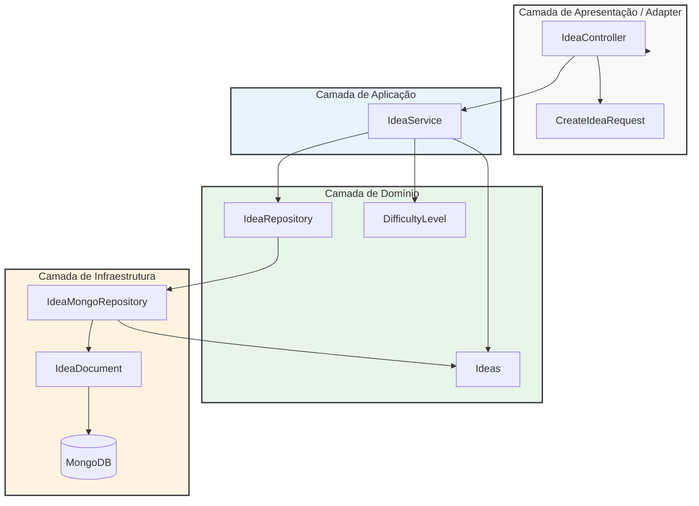

# Callidea

**Plataforma colaborativa de ideias e soluções** — um espaço para conectar pessoas que têm ideias inovadoras a pessoas capazes de transformá-las em realidade.

---

## Sumário

1. [Sobre o projeto](#1-sobre-o-projeto)
2. [Status atual](#2-status-atual)
3. [Arquitetura](#3-arquitetura)
4. [Use Case — Ideas](#4-use-case--ideas)
5. [Stack tecnológica](#5-stack-tecnológica)
6. [Próximos passos](#6-próximos-passos)

---

## 1. Sobre o projeto

O Callidea é uma plataforma colaborativa, com características de rede social, que busca conectar pessoas com ideias inovadoras a pessoas capazes de desenvolvê-las e transformá-las em soluções concretas.

A proposta é permitir que qualquer pessoa publique uma ideia e que outras pessoas interessadas possam desenvolver soluções, compartilhar os resultados e divulgar os links de seus projetos na plataforma.

Além de conectar ideias e execução, o Callidea pretende valorizar as contribuições individuais por meio de um sistema de reputação baseado em ideias publicadas e soluções avaliadas pela comunidade.

### Conceito de reputação

O sistema proposto utiliza dois indicadores complementares:

- **Lâmpadas:** cada ideia publicada representa uma lâmpada no perfil do autor. Elas contabilizam as ideias que uma pessoa compartilhou na plataforma, funcionando como um indicador de sua contribuição criativa.
- **Estrelas:** representam o reconhecimento recebido pelas soluções desenvolvidas e compartilhadas, com base nas avaliações de pessoas reais da comunidade.

Por exemplo, uma pessoa que publicou 10 ideias terá 10 lâmpadas em seu perfil. Se também desenvolveu cinco soluções, compartilhou seus links e recebeu, somadas, 1.250 estrelas nas avaliações da comunidade, seu perfil demonstrará tanto sua contribuição criativa quanto o reconhecimento recebido pelo que construiu.

As lâmpadas e as estrelas não representam a mesma coisa: as primeiras contabilizam ideias publicadas; as segundas refletem o reconhecimento das soluções desenvolvidas.

A intenção é que esses indicadores ajudem a comunidade a conhecer melhor as contribuições de cada pessoa, valorizando tanto quem identifica oportunidades quanto quem consegue transformá-las em realidade.

A visão do Callidea não se limita ao desenvolvimento de software. O projeto pretende expandir para diferentes áreas de conhecimento, nichos e idiomas, ampliando as possibilidades de colaboração entre pessoas com diferentes habilidades e experiências.

O objetivo técnico deste projeto é demonstrar, na prática, a construção gradual de uma aplicação baseada em **Clean Architecture**, utilizando:

- camada de **domínio** com entidades e conceitos de negócio;
- **portas** (interfaces) definidas pelas camadas internas;
- camada de **aplicação** para coordenar operações e casos de uso;
- **adapters** de entrada para comunicação REST;
- **adapters** de saída para integração com mecanismos externos de persistência.

---

## 2. Status atual

O projeto está em estágio inicial de desenvolvimento. A estrutura arquitetural e o primeiro fluxo de gerenciamento de ideias estão sendo construídos.

- **Domínio:** entidades (`Ideas`, `Users`, `Resolutions`, `Avaliations`), ports e value object (`DifficultyLevel`) estruturados inicialmente.
- **Aplicação:** primeiro serviço criado para `Ideas` (`IdeaService`), com operações iniciais de criação e consulta.
- **Adapters:** controller e DTO criados para `Ideas`.
- **Infrastructure:** documento MongoDB e repositórios relacionados à persistência de `Ideas`.
- **Build:** configuração Maven ajustada, com validação inicial do build e dos testes.

**Fase atual:** desenvolvimento do fluxo vertical inicial de `Ideas`, que servirá como referência para a evolução dos demais agregados.

A estrutura existente representa o início da implementação, não uma versão completa ou pronta para uso da plataforma. Funcionalidades como gerenciamento completo de usuários, publicação de soluções, avaliações e reputação ainda precisam ser desenvolvidas.

---

## 3. Arquitetura

**Regra de dependência:** as dependências do código devem apontar para dentro, em direção às regras centrais da aplicação. O domínio não deve depender de frameworks, MongoDB, REST ou mensageria.

As interfaces internas definem contratos, enquanto os adapters externos fornecem suas implementações. Dessa forma, a aplicação pode utilizar uma abstração de persistência sem precisar conhecer diretamente a tecnologia que a executa.

---

## 4. Use Case — Ideas

O primeiro fluxo desenvolvido contempla a criação e a consulta de ideias.

```mermaid
flowchart LR
    Client["Cliente / Frontend"] -->|"POST /ideas"| Controller["IdeaController"]
    Client -->|"GET /ideas/{id}"| Controller
    Controller -->|"create / findById"| Service["IdeaService"]
    Service -->|"save / findById / existsById"| Port["IdeaRepository"]
    Port --> MongoRepo["IdeaMongoRepository"]
    MongoRepo --> Document["IdeaDocument"]
    Document --> Mongo[("MongoDB")]

    style Client fill:#F9F9F9,stroke:#333,stroke-width:2px
    style Controller fill:#E8F4FD,stroke:#333,stroke-width:2px
    style Service fill:#E8F5E9,stroke:#333,stroke-width:2px
    style MongoRepo fill:#FFF3E0,stroke:#333,stroke-width:2px
```

### Operações contempladas

| Operação | Método HTTP | Endpoint | Descrição |
|---|---|---|---|
| Criar ideia | `POST` | `/ideas` | Receber os dados necessários para registrar uma ideia. |
| Consultar ideia | `GET` | `/ideas/{id}` | Buscar uma ideia pelo identificador. |

O controller recebe as requisições HTTP e delega as operações ao serviço de aplicação. O serviço utiliza o contrato `IdeaRepository`, cuja implementação de persistência é fornecida pelo adapter `IdeaMongoRepository`.

Esse fluxo constitui o primeiro recorte vertical da aplicação e servirá de referência para a evolução das demais funcionalidades.

> **Observação:** os diagramas Mermaid podem ser colados no [mermaid.live](https://mermaid.live) para visualização ampliada e interação.

---

## 5. Stack tecnológica

| Área | Tecnologia | Versão |
|---|---|---|
| Linguagem | Java | 21 |
| Framework | Spring Boot | 4.1.2 |
| Persistência | MongoDB | 8.0 |
| Mensageria | RabbitMQ | 3.13 |
| Cache | Redis | 7 |
| Segurança | Spring Security | 6 |
| Testes | JUnit 5 | 5 |
| Build | Maven | 3.9.9 |

Os badges no topo indicam as principais tecnologias associadas ao projeto. A presença de uma tecnologia na stack não significa que sua integração esteja concluída; os componentes serão configurados e incorporados conforme a evolução da aplicação.

---

## 6. Próximos passos

1. Evoluir o fluxo inicial de `Ideas` e consolidar suas regras de negócio.
2. Replicar o padrão arquitetural para `Users`, `Resolutions` e `Avaliations`.
3. Desenvolver a publicação de soluções associadas às ideias.
4. Implementar as avaliações da comunidade e o sistema de reputação por lâmpadas e estrelas.
5. Evoluir a configuração de persistência, mensageria, cache e segurança.
6. Adicionar testes para os casos de uso e adapters conforme as funcionalidades forem implementadas.

---

**Callidea — ideias que encontram pessoas, pessoas que constroem soluções.**